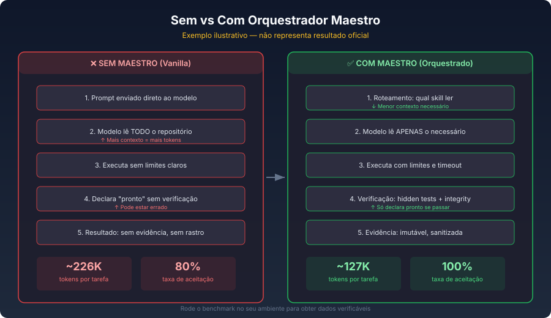
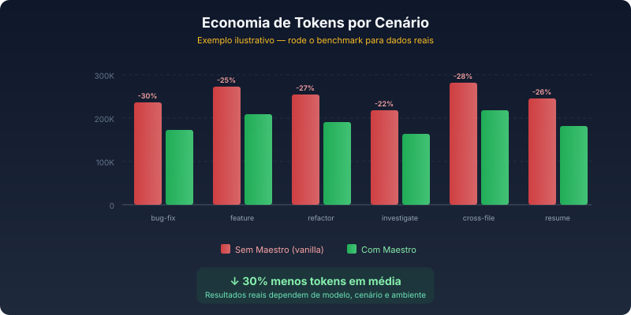
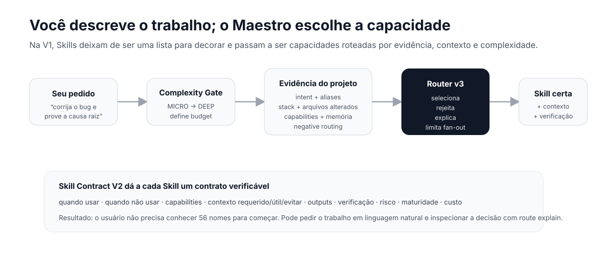

# Orquestrador Maestro

<p align="center">
  
</p>

<p align="center"><a href="README.md">Português</a> · <a href="docs/skills/README.md">Skills (PT)</a> · <a href="docs/installation.md">Install</a> · <a href="docs/benchmark.md">Benchmark</a> · <a href="CONTRIBUTING.md">Contribute</a></p>

> Use the same process across different AI tools: understand the task, read the necessary context, work within clear limits, verify the result, and leave useful state for the next session.

Orquestrador Maestro is for people who use Codex, Claude, OpenCode, Cursor, Gemini, and other AI tools on real projects. It is not a model and does not replace your preferred tool. It prepares the environment so tools spend less context, behave more predictably, and provide evidence before declaring work complete.

### Choose your next step

- [Understand the idea](#why-use-it)
- [Install now](#get-started-in-two-minutes)
- [Run the benchmark](#benchmark-run-it-on-your-machine)
- [Choose a skill](docs/skills/choose.md)
- [Read the technical guides](#keep-exploring)

## Why use it

With only a prompt, an AI can read too much, improvise its process, and call a task done without enough proof. Maestro organizes the path before execution.

| Without orchestration | With Orquestrador Maestro |
| --- | --- |
| The AI decides what to read alone | It starts with the right rules, state, and skill |
| Context grows without a boundary | It reads the minimum needed and deepens on demand |
| “Done” may only be an assertion | Verification and handoff are part of the work |
| Every tool invents its own ritual | The process carries across tools and sessions |


## Get started in two minutes

Requires Node.js 20.19 or later.

```bash
npm install -g @iapro/orquestrador-maestro-cli@latest
orquestrador-maestro install
orquestrador-maestro verify
```

The [installation guide](docs/installation.md) covers Windows, Linux, macOS, bootstrap, dry runs, and rollback.

**Next step:** [verify the installation](docs/installation.md#verificação), then [set up your first project](docs/project-dev-hierarchy.md).

## Benchmark: run it on your machine

The benchmark compares conditions with the same scenario, model, and acceptance criteria. It counts tokens only for accepted tasks and keeps evidence for review.



> **Illustrative example.** The values in this graphic are not a promise or official result. Actual outcomes vary by model, task, and environment. Run the benchmark to produce and inspect your own evidence.



The [benchmark methodology](docs/benchmark.md) explains its evidence gate, limitations, metrics, and reproducibility.

**Next step:** [inspect the generated evidence](docs/benchmark.md#evidence) before publishing a number.

## Skills: ask for the outcome, let Maestro choose the capability

You do **not** need to memorize Skill names. In V1, Router v3 selects specialized capabilities from intent, complexity, project signals, risk, and the Skill Contract.



```text
natural-language request
        ↓
Complexity Gate
        ↓
project signals + Skill Contract
        ↓
Router v3
        ↓
primary Skill
+ support only when justified
        ↓
bounded context
        ↓
execution + verification
```

A few examples:

| Goal | Typical capabilities |
| --- | --- |
| Understand a repository | preflight, repo health, deep documentation, ADRs |
| Build/evolve a product | engineering quality, frontend excellence, product UX architecture |
| Improve UI quality | open design, impeccable audit, design engineering craft, motion principles |
| Debug and prove a fix | systematic debugging, verification before completion |
| Ship safely | database migrations, release engineering, security |
| Work with AI/agents | AI orchestration, agent observability, explicit multiagent orchestration |

Inspect the routing decision before execution:

```bash
orquestrador-maestro route explain "investigate why this test started failing"
orquestrador-maestro route explain --json "prepare this application for release"
```

The canonical V1 catalog currently contains **56 Maestro Skills** (15 Core + 41 Domain) and **79 unique public Skills**. The architecture is designed so this catalog does not need to be eagerly loaded into the prompt.

The detailed Skills documentation is currently in Portuguese:

- [Skills portal (PT)](docs/skills/README.md)
- [Choose by objective (PT)](docs/skills/choose.md)
- [Recipes and combinations (PT)](docs/skills/recipes.md)
- [Full generated reference (PT)](docs/skills/reference/README.md)

## Durable plan execution (experimental)

Bridge v1 can admit a reviewed plan with `runs.submit`. The call persists an immutable manifest, a self-verifying approval receipt and an idempotent ACK; it does **not** start a provider. A Maestro-owned worker owns dispatch:

```bash
orquestrador-maestro bridge --stdio --with-worker --project-path /repo
orquestrador-maestro runs worker --project-path /repo --concurrency 1
```

Submissions stay `PENDING_WORKER` until a worker claims them. The worker runs the DAG in topological order, creates one Run per task, blocks descendants of failed tasks and records a Goal Loop decision without automatic re-dispatch. The full suite passed in public CI for Linux, Windows and macOS; real provider CLIs, macOS arm64, restart during execution and two clients on distinct hosts remain pending. See the full contract in Portuguese: [durable Run execution](docs/architecture/DURABLE_RUN_ADMISSION.md).


## Keep exploring

- [Installation](docs/installation.md)
- [How agents work with Maestro](docs/ai-agent-operating-guide.md)
- [Context economy](docs/context-economy.md)
- [Engineering quality](docs/engineering-quality.md)
- [Durable plan execution (PT)](docs/architecture/DURABLE_RUN_ADMISSION.md)
- [Skills portal (detailed documentation in Portuguese)](docs/skills/README.md)
- [Privacy model](docs/privacy-model.md)
- [Full technical documentation](docs/)

## Next step

**[Install Maestro](docs/installation.md)**, then **[run the benchmark](docs/benchmark.md#quick-start)** in your environment. Improvements are welcome through [contributions](CONTRIBUTING.md).

## Contributors

Orquestrador Maestro is shaped by ideas, development work and improvements shared over time. Thanks to everyone who helps build and improve the project.

<p align="center">
  <a href="https://github.com/FernandoBolzan"></a>
  &nbsp;&nbsp;&nbsp;&nbsp;
  <a href="https://github.com/kivervinicius"></a>
</p>
<p align="center">
  <a href="https://github.com/FernandoBolzan">Fernando Bolzan</a> &nbsp;·&nbsp; <a href="https://github.com/kivervinicius">Kiver Teixeira</a>
</p>

<p align="center">
  <a href="https://github.com/IAPro-Community/Orquestrador-Maestro/graphs/contributors">View GitHub contributors</a> · <a href="CONTRIBUTING.md">How to contribute</a>
</p>

The project welcomes contributions through code, documentation, testing, reviews and ideas.
